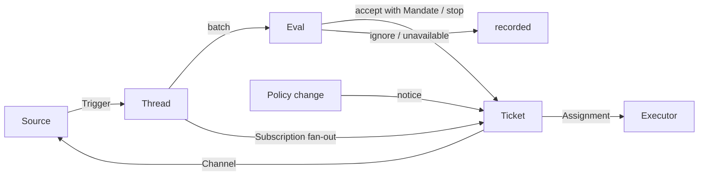

# 001 领域模型

这份文档给 dsh-superagent 的概念命名，并写下每一个概念守住的规则。代码、智能体调用的工具、面板和其他文档只用这些词，不用别的。遵循 [000 原则](000-philosophy_zh.md)，模型里只留工作需要的概念，一项业务需要成为其中某一个概念的属性。

## 流向

工作从触发到评估，再到执行。一个来源产出触发。一条触发作为上下文，扇出到订阅了它所属线程的工单。人的一条消息若是这样到达某张工单的，就留在那张工单上；其余每条触发都进入评估，由评估决定它是不是在要求新工作。评估接受时，它建一张带授权的工单。一次派工把工单交给一个执行器，结果再经渠道回到来源。

## 概念

来源、线程、评估、授权和订阅构成核心领域；其余的为它们服务。

| 概念 | 定义 | 它守住的规则 | 它为什么存在 |
| --- | --- | --- | --- |
| 来源 | 一条事件流。来源种类是一份可复用的实现；来源实例是某个种类的一份配置：它跑不跑、听什么 | 守住自己的读取位置和自己的机器人身份。定义什么算一件事件，包括只在一段时间上才成立的条件。在进入领域之前丢掉机器人自己的消息，以及监听范围之外的触发。把每条触发译成它所属的线程，以及用来回复的渠道地址 | 重启不得把事件再放一遍 |
| 触发 | 一件不可变的事件，带来源自己的元数据，例如它的行动者 | 属于一条或多条线程。同一条触发接受两次，只建一张工单 | 审计和幂等的单位 |
| 线程 | 按时间排好的触发；由来源定义哪些触发构成一条线程 | 同一时刻最多跑一次评估。它可以有多张工单。它持有自己的订阅、正在跑的评估，以及决定的历史 | 给评估一个一致的视图和它的上下文 |
| 关联 | 一条触发同时属于的那些线程之间的关系 | 只补充上下文；从不路由 | 让评估能顺着相关的证据看 |
| 渠道 | 一条线程的写入侧；地址由来源定义 | 一条线程可以有多个渠道；一张工单持有其中一组 | 确认收到、回复、拉取请求和已解决的评审，都是写 |
| 策略 | 带版本的研判规则，以及每个来源自己的那一部分：谁可以用该来源自己的身份经该来源发起工作、名单如何同步、哪些机器人可以成为候选 | 策略版本覆盖规则、接单模式和来源部分。波及一张活工单的变更，例如它被接受时所依据的规则变了，会送到它的派工；这不撤回授权。不同来源上的身份从不互相映射 | 规则一变，正在跑的评估必须丢掉 |
| 评估 | 对一批触发的判断，分两层：准入和研判 | 输入：这一批触发、一份线程快照、这条线程上的每张工单（含已结束的），以及当前策略。输出：一个决定。自己不存状态 | 决定新工作是开始、继续还是停止 |
| 授权 | 一次接受所给予的：策略版本、范围、强度、匹配到的规则、发送者在该来源上的身份，以及来源如何收到这条触发 | 不可变；范围变宽就是一张新工单。工单结束并不结束它：只有人的停止才撤回它，不再承认它的策略才撤销它。一张已结束的工单恢复之前，对照当前策略重新验证 | 说明为什么可以做这件事，以及可以做到多远 |
| 工单 | 一份得到授权的工作单位 | 只有评估能建一张。它指向自己的授权；持有自己的渠道和输入。从开放走到结束，人在它的某条线程上发来消息时再回到开放，除非有人把它停掉。它定义自己的状态，不跟随执行器的状态 | 拥有这次执行和它的报告 |
| 派工 | 一张工单与一个执行器实例的绑定 | 一张工单在时间上可以有多次。独立于工单，从待启动走到执行中再走到已结束。只有它的最终报告可以在执行器一侧结束这张工单 | 执行器在领域之外，但谁在执行必须在领域之内 |
| 订阅 | 工单与线程之间的多对多关系，由线程持有 | 一条匹配的触发扇出到每张活着的已订阅工单，不检查是谁发的；人的消息若这样到达一张工单，就不再做评估。执行器为了上下文而跟随的线程，也以同样的方式到达它的工单，但不借给它任何权威，也不恢复它。一张已结束的工单保留它的订阅，包括已关闭或已合并的拉取请求的订阅：人的消息在同一份授权下恢复它，没有评估，也没有决定；机器人和持续集成的消息到不了它，因为它的执行器在恢复时会重新读它的线程。被人停掉的工单什么都不收。主 Session 只有在消息明确指向某张已有工单时，才把一条线程附到那张工单上。人可以丢掉一条线程上的全部订阅；执行器只能丢掉它自己的工单对一条它认为无关的线程的订阅，它的工单起步的那条线程除外，来源让它跟随的线程也除外，例如它的拉取请求 | 后来的讨论到达执行器，不需要任何人再提一次智能体 |

人不是领域概念。一条触发带着行动者的标识，由来源给出。允许名单是某个来源在策略里的那一部分，用的是该来源的身份。同一个人在几个来源上各有账号，这是智能体在需要时才读的提示词。

执行器，连同它的会话和目录，在领域之外，通过派工接进来。

聚合：一个来源持有自己的读取位置。一条线程持有自己的订阅、自己正在跑的评估（评估串行运行，并把其间到达的触发并进下一批），以及决定的历史。一张工单持有自己的派工、渠道和输入，并按标识引用决定。

## 被拒绝的概念

| 被拒绝的 | 理由 |
| --- | --- |
| 把主体或成员身份做成实体，或把身份跨来源映射 | 人是触发的元数据；允许名单是来源在策略里的那一部分；跨来源映射是提示词 |
| 让评估自己调度延迟的触发 | 需要等待的条件就是一个普通来源，这样评估从不反向依赖来源 |
| 等待中或已撤销的评估状态 | 等待属于来源；一次评估超时就把触发重新排队，或结束为 `unavailable` |
| 一条线程上最多一张活工单 | 一条线程可以承载几件彼此独立的工作；研判靠工单列表避免重复 |
| 一种「追加到工单」的决定 | 追加就是订阅扇出，不需要评估 |
| 在订阅上做准入检查 | 订阅覆盖整条线程；授权把授权和上下文分开 |
| 会路由的关联 | 订阅负责路由；关联只补充上下文 |
| 跟随 DSH 会话的工单状态 | 一张工单可以交接、恢复，或由多个执行器来跑，所以它定义自己的状态 |
| 由执行器宣布有人要求它停 | 只有评估决定一次结束的强度 |
| 策略一变就取消正在跑的工单 | 取消到一半会留下做了一半的工作；变更改为记下并送出 |
| 执行器会话失败或受阻时锁住它的全部工具 | 那会拒绝直接在会话里工作的人，也会拒绝恢复之后的报告；暂停自动输入就够了 |
| 从报告的自由文本推断「在等人」 | 分类需要结构化的事实；执行器通过一个结构化字段来问 |

## 哪些可以复用

上面的概念和它们的规则可以复用。来源的实现、策略的内容、执行器和渠道的实现属于一次部署。每个来源在内部保留自己的说法，例如消息、群或通知，再把它们译成触发。

| 部分 | 在这个仓库里 |
| --- | --- |
| 来源 | 飞书：实时事件、历史补回、对已订阅话题的轮询。GitHub：通知、已订阅的议题和拉取请求、持续集成的变化、已合并或已关闭的拉取请求，以及在打开时，仓库里每条新议题、拉取请求和评论，还有默认分支的持续集成 |
| 策略 | 研判规则，以及每个来源的允许名单、它的同步、它的机器人名单和它的准入表 |
| 执行器 | 每个工单一份 DSH 执行器会话和一个目录，放在一份执行环境里，变量由执行器和来源登记 |
| 渠道 | 飞书话题回复、GitHub 评论和评审线程回复 |

## 术语表

这份以及后面的文档所用术语的对照，附上中文名；上面没介绍的术语，由后面的文档解释。面板一次只显示一种语言；它的（?）按钮打开这份两种语言都有的术语表。智能体在 GitHub 和飞书上发给人的消息用平常的话，不用这些术语。

| Term | 中文 | 含义 |
| --- | --- | --- |
| Agent | 智能体 | dsh-superagent 运行的那个自动化队友，经 GitHub 账号、飞书机器人这类身份在来源上行动 |
| Main Session | 主 Session | 评估触发、接受并分派工单、以及回复的那个 DSH 会话；代码和提示词里叫 `orchestrator` |
| Executor Session | 执行器 Session | 执行器为一张工单运行的那个 DSH 会话；代码和提示词里叫 `worker` |
| Source | 来源 | 一条事件流：插件提供的一个种类，加上一份实例配置 |
| Trigger | 触发 | 来自一个来源的一件不可变事件 |
| Thread | 线程 | 按时间排好的触发；评估在其中一次只跑一个的那个单位 |
| Correlation | 关联 | 共享一条触发的线程之间的关系；它只补充上下文 |
| Channel | 渠道 | 一条线程的写入侧 |
| Policy | 策略 | 接受工作的带版本规则，以及每个来源在其中的那一部分，例如谁可以在那里要求工作 |
| Policy version | 策略版本 | 规则、来源部分和接单模式的一种组合的标识；每份授权都记下它 |
| Eval | 评估 | 把一批触发变成一个决定的过程 |
| Gate | 准入 | 评估的确定性第一层：谁可以发起工作，以及以什么强度 |
| Assessment | 研判 | 评估过程中模型做的判断 |
| Decision | 决定 | 评估的结果 |
| Mandate | 授权 | 一次接受所给予的：强度、范围，以及它所依据的策略版本 |
| Ticket | 工单 | 一份得到授权的工作单位 |
| Assignment | 派工 | 一张工单与一个执行器实例的绑定 |
| Subscription | 订阅 | 一张工单和一条线程之间的关系 |
| Fan-out | 扇出 | 把一条已订阅线程的触发作为上下文送给一张工单 |
| Executor | 执行器 | 运行派工的端口：每张工单一份执行器会话和一个目录 |
| Execution environment | 执行环境 | 执行器会话和准备命令运行的地方：由执行器和来源登记的变量，每个有键、值和说明 |
| Report | 报告 | 一次派工向它的工单报告的状态 |
| Attention | 待人工决定 | 工单上一个等人回答的问题 |
| Disposition | 去向 | 一条触发被滤掉、被评估或被扇出的记录 |
| Input | 输入 | 送给一张工单的上下文：扇出的触发、策略变更、恢复和文本 |
| Scope | 范围 | 一份授权允许的工作 |
| Strength | 强度 | 一份授权或一次评估的依据有多强 |

| 组别 | 取值 |
| --- | --- |
| 决定 | accept 接单 · stop 停止 · ignore 忽略 · unavailable 未完成 |
| 强度 | explicit 明确 · inferred 推断 |
| 派工 | pending 待启动 · running 执行中 · ended 已结束 |
| 报告 | progress 进展 · waiting 等待 · ready 就绪 · blocked 受阻 · failed 失败 · dropped 无需处理 |
