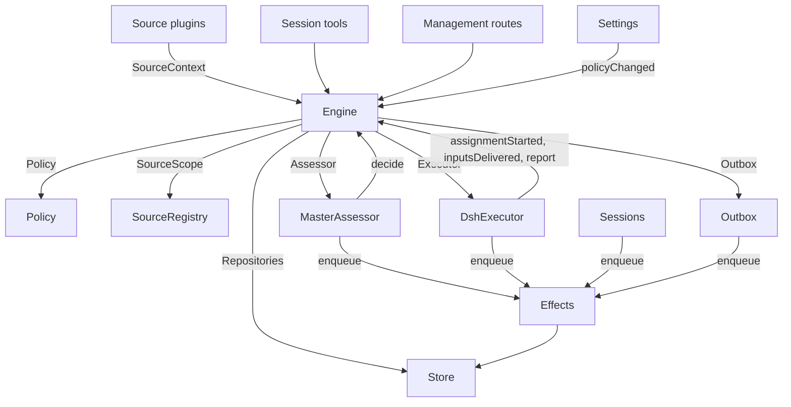

# 007 架构

这是面向实现的开发指南。它把 [001 领域模型](001-domain_zh.md) 一直到 [006 部署](006-deployment_zh.md) 里的概念，对应到类、接口和文件。先从运行时和引擎读起，再用模块表和测试表当作代码索引。

## 核心类与粘合层

核心类把领域概念和对外边界收在小接口后面。粘合层把工具参数、网络请求、来源载荷和 DeepSeek Harness 的事件译成对这些类的调用，再把结果变成卡片、视图和消息。

`Runtime`（`src/app/runtime.ts`）组装整个应用，供给依赖，并掌管启动与关闭。`Engine` 自己构造内部各部分。执行器和研判器会回调引擎，因此运行时交给它们的是取值器，而不是要求按会成环的顺序去构造。

### 运行时

`Runtime` 是组合根，里面没有领域规则。构造时锁住状态目录，打开存储，并建好每个组件。构造一旦失败，就关闭存储并放开锁。

启动时登记管理路由并运行准备。准备完成之后，装上会话与执行器的钩子，确保主 Session 存在，启动策略同步，恢复被打断的派工，并启动巡检与效应。`ready` 标志启动已经完成。

关闭时取消各个回合，等待巡检、效应和智能体，恢复进程环境，关闭存储并放开锁。来源插件通过窄接口 `SourceHost`，把运行时作为 `orchestrator` 服务注入。

| 部分 | 模块 | 做什么 |
| --- | --- | --- |
| 准备 | `src/app/setup.ts` | 按执行器外壳运行命令行的方式去探测，从而解析仓库和各个账号，写下并套用执行器的环境与命令垫片，并留着准备问题；设置经它检查改过的账号，也经它重启，重启会再跑一遍准备 |
| 巡检 | `src/app/passes.ts` | 一次只跑一轮，每两秒一轮，以及每当有命令要求时也跑一轮：先处理到期的效应，再调用 `Engine.evaluateDue`；来源的触发经它到达引擎 |
| 发件箱 | `src/app/outbox.ts` | 引擎的 `Outbox` 端口，也是回执的唯一写入者：`send` 在同一事务里留住一条消息的回执，并排队它的 `reply` 效应，该效应的处理者经 `SourceRegistry.send` 把它发出去；来源关掉时消息等待，对话没了或没人听时消息被丢弃 |
| 通知 | `src/app/notices.ts` | 把领域事件和执行器活动变成主 Session 的消息。`eventNotice` 处理领域通知；`reportRelay` 立刻转发提问，把普通进展留在其工单上，并转发其他报告；`followupRelay` 点名拥有人工后续的那些工单。回合进行中到达的转发，在下一步经宿主收件箱一起送达 |

### 引擎

`Engine`（`src/core/engine.ts`）是触发、线程、决定、工单和派工的唯一写入者。它从 `src/core/ports.ts` 收到这些端口：`Repositories`、一个取当前策略的取值器、`SourceScope`、`Assessor`、`Executor` 和 `Outbox`。可选依赖是 `prepareTicket`、`now` 和 `emit`。

引擎的方法全都是同步的。每条命令在一个事务里改自己的聚合。`evaluateDue` 对它改动的每一次评估或每一张工单使用单独的事务。端口在事务内部把外部工作排进队列；适配器在提交之后才去做。无效请求抛出 `UserError`。

引擎暴露一个入口，并委托给五个内部部分。它拥有每条命令的事务。跨部分的命令，例如 `attach`、`evaluateDue` 和 `policyChanged`，按顺序调用这些部分。

每个部分都扩展 `EnginePart`（`src/core/part.ts`），它提供选项和共用的读取。部分之间的依赖只朝一个方向流：

| 部分 | 职责 | 依赖于 |
| --- | --- | --- |
| `Intake` | 一条来源的触发：连同去向只存一次，记在它的线程及其关联上，扇出到已订阅的工单，并且除非它是一条已到达某张工单的人的消息，否则在其主线程上排队等待评估 | 工单 |
| `Evals` | 线程的评估：合批，准入的强度、行为者和依据，以及给出它们的那条触发（`primary`），从候选送达起算的截止及其因暂停而产生的推移，过期评估的重新排队，候选、重放和交还，策略变更时的重新排队，以及每一次结束时的决定：接单、停止、忽略或未完成 | 工单 |
| `Tickets` | 工单的生命周期：从一次接单创建，带上授权、订阅和第一次派工，它跟随的线程及其关闭（`followsDone`），附上的线程和只为上下文而跟随的线程，输入和备注，恢复以及恢复会拒绝的消息，重试、重启、停止和结束，它丢掉的订阅，以及策略变更对它所影响的工单的通知 | 回复 |
| `Assignments` | 执行器及其执行器 Session 所报告的：一次派工已开始，输入到达了或没到达，一次重启打断了它，以及执行器 Session 的报告和它向人提出的问题 | 工单、回复 |
| `Replies` | 经 `Outbox` 的渠道写入：确认、回答、结果和待人工决定的消息，每一条都按允许它的规则 | 无 |

命令用祈使式名字，例如 `stopTicket`；适配器报告的事实用过去式名字，例如 `assignmentStarted`。查询 `candidate` 用的是名词。

调用方只拿到引擎里自己这个角色的 `Pick`：`EngineForSources`、`EngineForMainSession`、`EngineForPeople`、`EngineForSettings` 或 `EngineForExecutor`。

| 角色 | 方法 | 效果 |
| --- | --- | --- |
| 来源 | `receive(trigger)` | 把一条触发只存一次，并回答 `stored`、`duplicate`，或在没有任何来源接收它时回答 `filtered`；把它扇出到订阅了其线程的工单，其中一个人的消息会立刻恢复已结束的工单，除非处理处于暂停，并在其主线程上把它排队等待评估，除非它是一条已经到达某张工单的人的消息，那就留在那张工单上 |
| 来源 | `bindThread(ticketId, thread, own)` | 让一张未结束的工单跟随来源的一条线程，例如一条拉取请求的线程，工单自己打开它时记为 `own`；一条已关闭的线程再次绑上就重新打开。结束工单的是这些线程的关闭，而不是一份 `ready` 报告 |
| 来源 | `threadClosed(thread, outcome, at)` | 一条线程关闭了：每一张跟随它且尚未结束的工单记下这次关闭，并在它跟过的线程都了结时结束（`followsDone`）：它打开的线程里没有还开着的，或者它一张都没打开时，它跟随的每一条线程都已关闭。它按这些关闭里最晚的那次，以 `merged` 或 `closed` 结束，除非关闭之后恢复的工作还没有报告 `ready`，或者它的执行器已经接手——用确认或回答的方式——一条它要在最新一份不是 `progress` 的报告之后、或最近一个回合结束之后才决定的人的后续；这时一份 `dropped` 报告会让它按那次关闭的方式结束 |
| 主 Session | `candidate(triggerId)` | 持有一条触发的那次评估，按它的研判者所看见的样子 |
| 主 Session | `candidateDelivered(evalId)` | 这次评估的候选已经到达主 Session：它的截止从现在起算 |
| 主 Session | `decide(triggerId, outcome)` | 记下一次评估决定，或对明确请求的直接决定。接单会原子地创建工单、授权、派工、订阅和确认。从卡片上忽略的推断候选，会在给出的原因之前记下 `ignoredFromCard`。当 `followupOwners` 仍拥有一条人工后续时，只允许停止 |
| 主 Session | `attach(ticketId, triggerId, note?)` | 把一条触发送到它指向的工单，该工单的执行器随后把它当作后续来决定，并结束持有它的那次评估，该评估里的其他触发等待一次新的评估；已结束的工单立刻在其授权下恢复，除非处理处于暂停。执行器仍在决定的后续会被拒绝，交还给把它交还的那张工单的也会被拒绝 |
| 主 Session | `requestStatus(ticketId)` | 向一场正在等待的执行器 Session 询问它的状态，并回答是否已经问过 |
| 主 Session | `note(ticketId, text)` | 把来自其他工作的一件事实，作为文本输入交给工单的执行器，这不授予任何东西 |
| 主 Session、执行器 | `reply(request)` | 为它的目的所点名的渠道排队一条消息：`acknowledgement`、`answer`、`result` 或 `attention` |
| 人 | `stopTicket(ticketId, reason?)` | 人的停止，这会收回授权 |
| 人 | `retryTicket(ticketId)` | 结束一张工单上停滞的派工，并开始新的一次。这张工单是在一份 `failed` 或 `blocked` 报告之后等人，或其输入送达失败了（`canRetry`） |
| 人 | `reevaluate(triggerId)` | 把一条已存储的触发排队，做一次新的评估 |
| 人 | `unsubscribe(thread)` | 丢掉一条线程上的全部订阅，跟随过它的工单不再跟随它；每一张仍继续决定它在那里收到的后续 |
| 人 | `dismiss(decisionId)` | 驳回一条 `unavailable` 决定所显示的问题，并由该决定记下这件事 |
| 执行器 | `assignmentStarted(ticketId, assignmentId)` | 一次派工在跑；它等着的输入发出去 |
| 执行器 | `inputsDelivered(ticketId, assignmentId, inputIds)` | 输入已经到达这次派工的执行器 Session，每一项都等着一个步骤来取走 |
| 执行器 | `inputsRead(ticketId, inputIds)` | 执行器 Session 已经把携带这些输入的消息收进自己的历史（一次 `user/message` 会话事件），模型因此拿得到它们；先前认领过它们、但在此之前被取消或失败的步骤不算。每一项要等一份报告或一个回合结束跟上来，才算已读，重启之后也一样，而且工单结束并不会放开它；在开始记录已读之前送达的输入，一旦一份报告或一个回合结束跟在它的送达之后，就算已读 |
| 执行器 | `turnEnded(ticketId, assignmentId)` | 执行器 Session 的一个回合结束了，也包括一份报告之后，此时后台没有还在为它跑的东西，或者它正把事情交给一个人。步骤先前拿走的，都算它已读（`inputsRead`） |
| 执行器 | `deliveryFailed(ticketId, assignmentId, error)` | 送达输入失败了；工单会显示这件事，直到一次送达成功、新的派工开始或工单结束 |
| 执行器 | `report(ticketId, report)` | 记下一份报告以及它向人提出的问题；`dropped` 结束工单，`ready` 完成一张不跟随任何线程的工单，并按所跟随线程结束的方式，结束一张已经跟这些线程了结的工单 |
| 执行器 | `markUnrelated(ticketId, thread, reason)` | 只丢掉那张工单对一条它发现无关的附上线程的订阅，并把那里由该工单决定的后续连同原因交还 |
| 执行器 | `followForContext(ticketId, thread)` | 让一张未结束的工单为上下文订阅一条相关线程：它的消息会到达工单，但不借给它后续的强度，也不恢复它 |
| 执行器 | `handback(ticketId, triggerId, reason)` | 记下这张工单把一条到达过它的触发交还，原因由它的候选带着，并且一旦没有别的工单还在决定它（若这张工单曾经在决定），就把它排队做一次新的评估；它回答自己是否把它排上了队。一张工单对每条触发只交还一次，并保留自己的订阅 |
| 执行器 | `assignmentInterrupted(ticketId, assignmentId)` | 宿主停下时有派工正在跑：在工作中途被打断的，或在最新一份报告之后又收到输入的，会像重试那样重新开始，并带上恢复说明，以及已经送到它、但执行器 Session 还没取走的输入；自那以后已经报告过的，保留它的会话。执行器实现在启动时逐一报告（`resume`），先是最旧的工单，并把仍在等待的启动重新排队 |
| 巡检 | `evaluateDue()` | 除非处理处于暂停：启动那些有排队触发在等的线程的评估，每条线程一次，其间排上的触发合成一批；把过了截止时间的评估的触发重新排队，连续两次，第三次记为 `unavailable`；并恢复暂停期间被人的消息到达过的已结束工单，只要它们的授权仍然成立。候选还没到达主 Session 的评估不会过期。处理暂停期间，没有评估会过期，一旦恢复，每个截止时间都按暂停的时长往后移 |
| 设置 | `policyChanged(from, to, effects)` | 告诉每一张这场变更所影响的活工单，影响是怎样的（`src/policy.ts` 里的 `policyEffects`：它被接单时所依据的规则变了或不再适用，它的请求者也许不能再开工，或者不再接受主动发起的工作），并在新版本下重开进行中的评估 |

引擎把合批、授权、扇出、恢复和待人工决定的生命周期规则留在内部。几个共用谓词让这些规则保持一致：

- `waitsForPerson`（`src/core/model.ts`）：最新派工报告了 `blocked` 或 `failed`，且此后没有人的消息到达。在此期间，自动输入和失败的启动都继续被压住。
- `followupOwners`：仍对在自己线程上收到的人工后续负责的那些工单。一张工单可以是活着的，也可以是已结束但并非被人停止、正等着恢复。把消息交还就结束这份责任。
- `settled`：一条决定已经了结该请求；停止、未完成、已转送和拒绝停止的决定不算。
- `ticketStage`（`src/core/stage.ts`）：实现 [003 执行](003-execution_zh.md) 里的阶段表。

工单结束时，未读的后续回到评估，除非另一张工单仍拥有它们，或另一种去向已经把它们了结。已确认、已回答和已交还的消息除外。较旧的记录若没有确认去向，发件箱回执提供这一事实。一份最终报告也覆盖派工开始时正等着的消息，包括把它恢复起来的那条消息。把工单停掉的那条消息不会自动重新评估。

一次变更之后，引擎从 `src/core/ports.ts` 里的 `DomainEvents` 发出一个事件：

`trigger.received`、`eval.started`、`decision.recorded`、`ticket.created`、`ticket.resumed`、`ticket.ended`、`assignment.started`、`assignment.ended`、`thread.subscribed`、`thread.unsubscribed`、`trigger.requeued` 或 `policy.changed`。

运行时把 `ticket.ended`、`trigger.requeued` 和 `thread.unsubscribed` 变成通知。送达工单的、来自人的 `trigger.received` 变成一条后续转发。工单以合并或关闭结束时，`pullEndNotices` 用一个稳定标识发出一条聊天通知。其他事件目前没有消费者。

### 模型

`src/core/model.ts` 放着领域类型，`src/core/stage.ts` 放着工单阶段。一条决定用 `reason` 记下原因，那是一组 `Reason`（`src/core/reasons.ts`）：每一项是一个 `code` 及其 `values`，若属于一批里的某一条触发，还有它的 `triggerId`。

核心自己的代码，例如 `timeout`、`policyChanged`、`routed` 和 `startedTicket`，都在 `REASONS` 里，智能体经 `reasonText` 读到的是英文；准入或来源范围可以给出自己的代码，例如 `not_a_member`；`said` 带着研判者或人写下的话。面板用 `reason.<code>` 给每个代码配词，来源滤掉的触发也按同样方式记下该来源的代码。

一张工单每件事实只留一次。没有 `ended` 时它就是开着的；这一字段记下它何时、由谁、为何、以什么结局结束。它最后说的是最新一份派工报告（`latestReport`）。它的执行器 Session 按它来命名（`workerSessionId`，见 `src/executor/dsh.ts`）。

它的字段是定型的：`origin` 是那条为评估批次给出强度的可准入触发，以及批次本身（`triggerId`、`triggerIds`）；`execution` 是执行器选定的内容（`name`、`directory` 和 `assignment`）；`delivery` 是最近一次失败的输入送达（`error`、`at`），直到一次送达成功、新的派工开始或工单结束；`follows` 是来源让它跟随的线程，每一项是 `{thread, own, closed?}`：工单自己打开它时为 `own`，关闭之后 `closed` 带上 `at` 和 `outcome`。只有工单部分写入 `follows`；GitHub 来源用 `pullsOf` 和 `pullOf` 读取它的拉取请求（`src/sources/github-pull.ts`）。

携带触发的输入会记下是不是人写的，`waitsForPerson` 读的就是这个。一条线程还在 `context` 里列出只为上下文而跟随它的已订阅工单，并在 `expired` 里计数它那些排队触发的评估连续过期了多少次；一次评估记下它的 `primary` 触发，以及候选何时被 `delivered`。

一条触发的去向记下它到达过的工单，经由扇出或附上，还有人的重新排队，每一张把它交还的工单及原因，以及执行器确认过或回答过它的每一张工单。

授权的 `basis`（`MandateBasis`）记下准入如何放行它的触发。再校验读取接收侧的 `source`、`scope` 和 `row`，名单上的 `sender`，匹配的 `rules`，以及 `via`：

| `via` | 准入依据 |
| --- | --- |
| `addressed` | 允许的发送者对智能体说了话 |
| `followup` | 一条消息到达一条已有工单的线程 |
| `admission` | 准入表的一格；`observation` 标记一个推断候选 |
| `bot` | 名单上的机器人产生了一个推断候选 |

触发和线程的 `meta` 属于来源。核心不去解释它们。

### 策略

`src/policy.ts` 定义设置的结构、授权和研判规则。`settingsPolicy(settings, scope)` 在每次使用时返回一份新的、无状态的 `Policy`：

- `version`、`paused` 和 `evalTimeoutMs` 描述它的当前状态。
- `gate(trigger, thread, tickets)` 返回准入强度和依据。
- `revalidate(mandate)` 检查一份已有授权是否仍然成立。
- `admitsInferred(rules)` 只在自动模式且匹配规则已启用时，才允许主动接单。

`assessmentOutcome(assessment, settings, strength)` 把模型的研判转成引擎的结局。它要求每一条启用的规则都有判断、方向已经了结、有一条匹配的规则，以及有意图的证据。在自动模式之外，一次推断的接单变成一条“本来会接单”的记录。

`policyEffects(tickets, old, now, scope)` 认出一场变更影响哪些未结束的工单，以及如何影响。`Engine.policyChanged` 只通知那些工单。`policyVersion` 对规则、接单模式和各来源的策略部分（包括机器人名单）做散列。

### 存储

`Store`（`src/app/store.ts`）拥有一个 SQLite 数据库。运行时在打开它之前取得目录锁，以免第二个进程迁移或写入同一份状态。

它的接口按用途分组：

- **领域仓库：** `atomic`，加上 `triggers`、`threads`、`tickets` 和 `decisions`，各自带有 `get`、`save` 和列表查询。有索引的工作集是 `threads.active()`、`tickets.open()`、`tickets.active()` 和 `read.subscribedThreads`。
- **只读查询：** `read` 经 `threadTriggers`、`triggerStats`、`search` 和 `droppedReplies` 等方法，为视图、工具和来源轮询服务。这些方法从不写入。
- **来源元数据：** `threads.describe` 和 `threads.patchMeta` 更新来源拥有的线程元数据。
- **设置：** `settings`、`saveSettings`、`blockRevision` 和 `settingsHistory`。设置和提示词使用带编号的 `Versions`（`src/app/versions.ts`）。
- **发件箱回执：** `replyStatus` 和 `receipts`，只由发件箱写入。回执操作是 `get`、`waiting`、`behind`、`add`、`settle` 和 `withdraw`。`behind` 检查同一工单、同一对话是否有一条更早的消息正在等待，且失败少于三次。被撤回的消息以 `channelGone` 或 `channelIgnored` 了结。只读查询经 `failingReplies`、`droppedReplies` 和 `droppedSince` 暴露失败的和被丢弃的回复。
- **定型的键值记录：** `get`、`set`、`delete` 和 `keys`，使用 `KV` 里的条目。

`afterCommit` 只在事务提交之后运行一个动作，回滚之后从不运行。运行时按存储的形状读取记录；第 11 版结构迁移在启动时转换仍受支持的较旧记录。

### 效应

`Effects`（`src/app/effects.ts`）是持久的副作用队列。一条命令在自己的事务里调用 `enqueue(kind, key, payload)`；执行要到提交之后才开始。

每种和键的一对只有一行。把同一个正在等待的键再排进去，会换掉它的载荷，并让它立刻到期，但不改变队列顺序。`handle(kind, run, options)` 为每种登记一个处理者。它按最旧的优先处理到期的行，直到并发上限。

失败按指数退避重试。抛出 `Later` 会推迟工作而不计一次失败，例如没有空闲的执行器名额时。`start` 在准备之后开始处理，`drain` 在关闭期间停掉处理但保留未完成的行，`pending` 与 `idle` 暴露队列状态。

| 种类 | 处理者 | 做什么 | 同时 | 重试 |
| --- | --- | --- | --- | --- |
| `assessment` | 主评估器 | 把一次评估的候选卡片送进主 Session 的回合，然后告诉引擎它已送达，评估的截止从此起算 | 同时四个，暂停时不跑 | 2 秒起，倍增到 60 秒 |
| `launch` | 执行器实现 | 启动一项待处理的派工：准备命令、执行器 Session、派工消息 | 空闲的执行器名额，暂停时不跑 | 模型提供方或网络的一次可继续的短暂失败，会在 5 秒起、倍增到 300 秒之后再跑，一共三次；任何其他失败，以及准备命令失败，都会让其工单失败。被暂停或被占满的执行器名额拦住的那一项，5 秒后再试 |
| `delivery` | 执行器实现 | 按顺序把工单上等着的输入交给正在运行的派工 | 同时四个，暂停时不跑 | 2 秒起，倍增到 60 秒；正在等执行器名额的那一项，2 秒后再试 |
| `relay` | 会话 | 把执行器的报告或提问，或一个人的后续，送进主 Session 的回合 | 同时一个，按队列顺序 | 2 秒起，倍增到 60 秒 |
| `notice` | 会话 | 把一条通知注入主 Session，但不叫醒它 | 同时一个，按队列顺序 | 2 秒起，倍增到 60 秒 |
| `reply` | 发件箱 | 经其来源为渠道发送一条消息，要排在同一工单发往同一对话、且尚未失败三次的更早消息之后；撤回该消息即取消发送 | 同时一个，暂停时不发 | 5 秒起，倍增到 300 秒；来源关掉的，或排在更早消息后面的，5 秒后再试 |

每种在自己的名字下有一项健康记录。一旦它的某个效应连续失败三次，就报告错误，但 `delivery` 除外，它的失败改显示在工单上。转发保持顺序，通知也是；失败的一条会拦住它这一种里更晚的那些。

### 来源

来源经 `SourceKind` 扩展宿主；这个协议定义在 `src/sources/kind.ts`。一个种类声明自己的身份、标题、描述、配置 `schema` 与 `fields`、派生的 `facts`，以及 `health` 项。可选行为包括 `scope`、一个 `channel`（`allowed`、`send`、`link`）、`threadContext`、`find`、`policy`、`environment` 和 `refreshLabels`。

`SourceRegistry`（`registry.ts`）拥有已登记的种类和已存储的实例，并实现引擎的 `SourceScope`。登记时在 `HealthBoard` 上认领健康项；重复认领和保留的 `sync:` 名称会被拒绝。一份来源上下文只经自己登记时认领的那些项来写，因此注销之后的上报不起作用。

注册表的配置方法包括 `kind`、`instances`、`instance`、`validate`、`validatePolicy`、`policyPart`、`channelAllowed`、`declarations`、`environments`、`find` 和 `scope`。`find` 询问每一个支持搜索的种类。

通用代码经注册表访问来源的行为。`send(message, commands)` 调用该种类的渠道，并返回 `sent`、`gone`，或在种类未安装时返回 `waiting`。`link` 解析它的渠道链接。`threadContext` 把一个种类的读取器配上它的配置，种类没有读取器时什么都不返回。存下来的配置若无效，该实例就被停用。

插件收到 `SourceHost`：注册表和 `context(kind)`。种类本身使用更窄的 `SourceContext`，由 `src/app/source-context.ts` 里的 `sourceContextOf` 建成。

该上下文提供部署和命令、准备是否就绪（`ready`、`configured`、`problem`）、配置、`receive`、`atomic` 和定型的 `state`。它也暴露线程的读取和元数据写入、工单的读取以及绑定与关闭命令、触发的读取、经发件箱的 `notify`，以及对已声明健康项的 `report`。

### 执行器实现

`DshExecutor`（`src/executor/dsh.ts`）为每张工单提供一场执行器 Session 和一个目录。`start` 和 `deliver` 把 `launch` 与 `delivery` 效应排入队列。`stop` 经 `Store.afterCommit` 取消回合，因此回滚掉的结束不会停掉执行器。

`prepare(ticket, outcome)` 供给引擎的 `prepareTicket` 钩子：短名、目录和 `ticketExecution` 的派工文本。`workerSessionId(ticket.id)` 派生会话标识。

`WorkerSlots` 在一次启动之前，或在一次会叫醒空闲执行器的送达之前，预留容量。一条人的消息可以使用超出 `maxWorkers` 的一个名额，叫醒优先于启动。`activeCount` 提供面板上的负载。

模型提供方和网络的短暂失败有三次重试。启动使用效应的退避；失败的回合在 15、30 和 60 秒后收到继续做下去的消息。`inputMessage` 按工单当前状态渲染每一项输入，`mandateInstructions` 为推断的工作加上所匹配规则的限制。

`install` 订阅会话事件；`dispose` 取消订阅。回合结束通常报告等待，除非已经就绪，或正需要人来行动。错误报告失败。启动时，`resume` 经 `assignmentInterrupted` 报告被打断的派工，并把并不等人的待处理启动重新排队，先是最旧的工单。

### 主评估器

`MasterAssessor`（`src/app/assessment.ts`）让主 Session 研判主动发起的候选。`request` 排队一次研判效应；`release` 在它的评估结束时丢掉缓存的状态。

它的 `context`、`read` 和 `decide` 方法服务于 `orchestrator_eval`、`orchestrator_eval_read` 和 `orchestrator_eval_decide`。它们经 `SourceRegistry.threadContext` 提供有界的线程上下文、仓库上下文，以及决定的提交。没有上下文读取器的种类只提供触发和批次。

`assessmentOutcome` 为 `Engine.decide` 转换模型的回答。评估会按当前策略再检查一次推断的接单。

### 设置

`Settings`（`src/app/settings.ts`）读写带修订的设置块。`current` 和 `view` 读取它们；`save(block, value, revision, origin)` 校验一次保存；`pause(paused, origin)` 改动单独的 `paused` 设置。

每一次保存都声明自己的出处：`panel`、`tool` 或 `sync`。只有 `panel` 能改执行环境，或 `SETUP_FIELDS`（`src/deployment.ts`）列出的字段。

策略版本一变，就算出 `policyEffects`，记下哪些工单被通知了，并调用 `Engine.policyChanged`。`syncable` 和 `sync(id)` 刷新一个来源的策略部分。`refreshLabels(id)` 刷新显示名称。

### 提示词

`Prompts`（`src/app/prompts.ts`）把配置存成 `Versions`。`current`、`version` 和 `history` 读取它们；`validate`、`preview` 和 `save(value, baseRevision, source)` 检查并保存它们。`compose` 和 `skills` 构建会话文本。

`builtInParts` 列出可覆盖的键、角色、默认文本和必需的模板占位。每一份覆盖存着团队的 `text` 和一个 `base`：其原始默认的 `builtInBase` 键。保存把那份默认留在 `KV.prompts.builtIn` 之下。`defaultChanged` 随后报告变了的默认、能拿到时的旧文本，以及被去掉的部分。

校验时，省掉的基线从已保存的覆盖继承，丢掉已经出现在已保存数据里的被移除部分，并拒绝空白文本或其他未知键。这样保存工具就能把读到的配置原样走一个来回。`environmentSection` 和 `policySection` 只使用自己的键，把模板值替换一次。没有覆盖的配置使用默认。

### 会话

`Sessions`（`src/app/sessions.ts`）为两种角色管理宿主中的会话。`ensure` 用该角色的模型创建一场会话。`install` 跟随智能体事件，并为受管会话登记提示词、技能和工具。

`prompt` 对每个请求标识只送达一次。`relay` 和 `notify` 把主 Session 的消息排进由 `relay` 与 `notice` 效应处理的队列。内容由 `src/app/notices.ts` 定义；`delivery` 检查一条消息是否到达。

每一次模型请求都把会话绑到当前的提示词修订。它用过的修订会持久保存：`promptVersion` 标识当前生效的那一版，`mayRead` 限制执行器可以查看哪些版本。登记按每个智能体一张表来跟踪。

`status` 和 `promptVersion` 供提示词页面使用。保存走 `Prompts.save`，并通知主 Session。`modelRetry` 暴露模型额度重试的状态。

### 粘合层

| 粘合 | 译成什么 |
| --- | --- |
| `src/app/runtime.ts` | 组合根：用各部分所用的接口把它们建起来，登记路由和来源用的宿主服务，并启动和停止 dsh-superagent |
| `src/app/notices.ts` | 领域事件和执行器报告，变成给主 Session 的通知和转发 |
| `src/app/tools/main.ts`、`src/app/tools/executor.ts` | 主 Session 和执行器 Session 的工具参数，变成对核心类的调用，它们的结果变成卡片 |
| `src/app/http.ts`、`src/app/views/`、`src/app/api.ts` | 网络请求变成调用，存储的读取变成面板的视图；`api.ts` 为面板给每一条路由定类型 |
| `src/app/resources.ts`、`src/app/links.ts`、`src/app/cards.ts` | 资源名变成读取，来源消息变成链接，记录变成给模型的紧凑卡片 |
| `src/sources/github*.ts`、`src/sources/feishu*.ts`、`src/sources/poll.ts` | GitHub 与飞书的载荷变成触发和线程事实，消息变成命令行调用 |
| `src/deployment.ts`、`src/setup.ts`、`src/infra/` | 准备的探测和问题、命令行传输、智能体的进程环境 |

## 依赖规则

- **依赖明确而且窄。** 每个类收到的接口只点名它用到的东西，大多是其他类的 `Pick` 类型：核心类用 `ExecutorHost`、`AssessorHost`、`SessionsHost`、`SettingsHost`、`SetupHost`、`PassesHost` 和 `OutboxHost`，粘合层用 `HttpHost`、`MainToolsHost`、`ExecutorToolsHost`、`ResourceHost`、`LinkHost` 和 `SourceContextDeps`，引擎则是调用它的那个角色的 `Pick`。运行时只有躲在这样的接口后面才把自己传出去。来源插件注入 `orchestrator` 服务，其类型把它命名为 `SourceHost`：注册表和 `context(kind)`；该种类的代码只看得到自己的 `SourceContext`。
- **谁可以导入谁。** `src/core` 除了 Node 提供的散列之外，不导入自身以外的东西，也不做输入输出。`src/sources` 不从 `src/app` 导入任何东西。面板从宿主一侧只导入类型，以及 `src/admission.ts`、`src/limits.ts`、`src/setup.ts`、`src/navigation.ts`、`src/sources/host.ts`、`src/core/errors.ts`、`src/core/reasons.ts` 的普通值，和 `src/app/api.ts` 的过滤器列表。
- **一种状态只有一个写入者。** 每一种状态有一个写入者，其余的读取它，或请那个写入者去写。

  | 状态 | 写入者 |
  | --- | --- |
  | 触发、线程、决定、工单、派工 | 引擎 |
  | 某一来源的读取位置，以及它留在自己线程上的元数据（`label`、`url`、`facts` 和它自己的键） | 该来源，经 `SourceContext` |
  | 设置及其历史 | 设置 |
  | 提示词版本 | 提示词 |
  | 效应行 | 效应 |
  | 发件箱回执 | 发件箱：引擎的消息和来源的 `notify` 都走它的 `send`，它的 `reply` 效应给它们做标记 |
  | 一项健康记录 | 在 `HealthBoard`（`src/infra/health.ts`）上认领它的那一部分，第二次认领会被拒绝：`runtime` 由运行时写入，巡检经它上报，`evals` 由运行时在每一轮巡检之后写入，`models` 由会话写入，每一种效应由效应队列写入，`worker` 由执行器实现写入，某一来源种类的各项由该种类来源的注册表写入，`sync:<id>` 由设置写入 |

  来源改动工单，只经 `SourceContext.tickets.bindThread` 和 `threadClosed`，二者都会调用引擎。
- **请求与事实。** 请求某事的方法用祈使动词加对象来命名，例如 `stopTicket` 或 `bindThread`，并且可能被拒绝；记下适配器已经做了什么的方法用过去式命名，例如 `assignmentStarted` 或 `deliveryFailed`。每一个依赖接口的实现方拿到的引擎，都是它这个角色所需的那一截。
- **字段定型，来源的数据归来源。** 代码读取工单和授权的定型字段。来源不在工单上留自己的东西：工单跟随它的哪些线程，是工单的 `follows`；它对一条触发或一条线程所保留的，在它们的 `meta` 里。
- **拒绝是固定的。** 人或智能体能够引起的拒绝，是 `src/core/errors.ts` 里 `USER_ERRORS` 中的 `UserError(code, values)`。管理接口对 `missing` 代码回答 404，对其余回答 400，面板用自己的语言给每个代码配词。准备问题是 `SetupError` 代码（`src/setup.ts`），固定的健康文本是 `HealthCode`（`src/sources/host.ts`），配词方式相同。

### 与具体来源相关的依赖

有些通用模块仍然直接提到 GitHub 或飞书：

- 发件箱套用飞书聊天的字数上限。
- `src/app/links.ts` 解析飞书消息链接和 `repliedTo`。它和运行时用 `feishuSettings` 读取设置。
- `src/app/resources.ts` 读取 `feishu/` 和 `github/` 的原文；`src/app/cards.ts` 为工单卡片使用 `pullOf`。
- 运行时为已合并或已关闭的工单发送 `pullEndNotices`。
- 执行器工具用 `readPull` 和 `claimPull` 绑定所报告的拉取请求，使用运行时暴露的 GitHub 上下文。
- 主评估器用 `readRepositoryPath` 读取仓库文件。
- 会话和提示词只为 GitHub 和飞书登记内置技能。迁移会转换它们第 10 版结构的记录。
- 准备只探测 GitHub 和飞书的账号字段（`SETUP_FIELDS`）。只有这些来源经 `SourceContext.problem` 收到账号准备问题。

## 模块

| 路径 | 职责 |
| --- | --- |
| `src/index.ts` | 主插件入口：读机器设置，启动运行时，并把来源账号的一次保存所使用的重启交给它 |
| `src/deployment.ts` | 插件的 `Config` 与 `Machine`；`resolveDeployment` 和 `resolveFeishuBot` 从来源设置读取仓库和各个账号，每一条命令行都按执行器外壳运行它的方式来跑；`SETUP_FIELDS` 列出准备会读的来源字段。代码不点名任何人、账号或组织 |
| `src/setup.ts` | 准备问题：`SetupError`，带一个代码、修正它的位置，以及日志、主 Session 和面板共用的英文文本 |
| `src/policy.ts` | 策略：按块划分的设置结构、策略版本、准入，以及授权的再校验 |
| `src/admission.ts` | 准入表的值、每一格的选项和默认，与面板共用 |
| `src/limits.ts` | 人可以设定的值的界限，设置结构会检查，面板的字段也提供这些界限 |
| `src/kv.ts` | `KV`：`kv` 记录的每一个族，及其键、值的类型和所有者，还有存储与 `SourceContext.state` 所接受的 `Key` 和 `Family` 类型 |
| `src/navigation.ts` | 一旦宿主的目录列出它，就从面板打开宿主中的那场会话 |
| `src/core/model.ts` | 领域类型，其中包括定型的工单和 `MandateBasis`，以及 `threadKey`、`ticketOutcome`、`reached`、`followupOwners`、`settled`、`waitsForPerson`、`liveTicket`、`runningAssignment`、`latestAssignment` 和 `latestReport` |
| `src/core/ports.ts` | 端口：`Repositories`、`Policy`、`SourceScope`、`Assessor`、`Executor`、`Outbox`，以及领域事件 |
| `src/core/engine.ts` | 引擎，核心的入口，以及角色接口 `EngineForSources`、`EngineForMainSession`、`EngineForPeople`、`EngineForSettings` 和 `EngineForExecutor` |
| `src/core/part.ts` | `EnginePart`，引擎各部分的基类，以及 `EngineOptions` |
| `src/core/intake.ts` | `Intake`：来源来的触发，送到它们的工单，并且除非人的消息已到达某一张，否则送到评估 |
| `src/core/evals.ts` | `Evals`：线程的评估及其决定 |
| `src/core/tickets.ts` | `Tickets`：工单生命周期、工单跟随的线程、订阅和输入 |
| `src/core/assignments.ts` | `Assignments`：执行器的事实，及其执行器 Session 的报告 |
| `src/core/replies.ts` | `Replies`：引擎的渠道写入 |
| `src/core/stage.ts` | `ticketStage` 和 `canRetry`：[003 执行](003-execution_zh.md) 的工单阶段 |
| `src/core/errors.ts` | `UserError` 与 `USER_ERRORS` |
| `src/core/reasons.ts` | `Reason`、`REASONS` 和 `reasonText`：核心为何记下一条决定或把一条触发搁置，按代码 |
| `src/core/ids.ts` | `key`：由输入派生的标识，输入相同则标识相同 |
| `src/core/memory.ts` | `MemoryRepositories`：存储的仓库的内存版，顺序与存储相同，并带有它的嵌套回滚，供领域测试使用 |
| `src/core/index.ts` | 核心的导出 |
| `src/app/runtime.ts` | 运行时，组合根，及其启动和停止 |
| `src/app/setup.ts` | 准备，以及 `setupChanged`，即一次保存是否改动了准备会读的字段 |
| `src/app/passes.ts` | 巡检，也就是巡检的调度器 |
| `src/app/outbox.ts` | 发件箱：引擎的 `Outbox` 端口、回执，以及把它们发出去的 `reply` 效应 |
| `src/app/notices.ts` | 主 Session 的通知和转发：`eventNotice`、`reportRelay`、`resultRelay` 和 `followupRelay` |
| `src/app/store.ts` | 存储，以及 `Receipt`，发件箱的一条消息 |
| `src/app/store-read.ts` | `storeReads`：存储的只读查询，供视图、工具和来源的轮询使用，它们从不写入 |
| `src/app/migration.ts` | 第 11 版结构迁移：从第 10 版走一步，把每一条已存记录按当前形状写回去 |
| `src/app/effects.ts` | 效应 |
| `src/app/versions.ts` | `Versions`：一份记成带编号快照的记录，并有指针指向当前一份，用于设置和提示词 |
| `src/app/cache.ts` | `TextCache`：按大小留在内存里的文本，最久未用的先丢掉 |
| `src/app/settings.ts` | 设置 |
| `src/app/settings-history.ts` | `policyHistory`：每一次保存的设置修订，以及它相对前一版改了什么 |
| `src/app/prompts.ts` | 提示词、`builtInParts`（团队可以覆盖的内置部分），以及 `promptParts`（一个角色的提示词各节的顺序） |
| `src/app/context.ts` | 内置提示词文本，从 `prompts/` 读取，以及会话所读的记录条目 |
| `src/app/skill-files.ts` | 打包的文本：`promptFile` 把文件里一行一句拼成段落，以及随包的技能 |
| `src/app/sessions.ts` | 会话 |
| `src/app/delivery.ts` | `AgentDelivery`：按每个请求标识只向宿主里的智能体送达一次消息，恢复后的会话也一样 |
| `src/app/retry-health.ts` | `RetryHealth`：哪些会话正在等模型额度重试，供 `models` 健康项使用 |
| `src/app/role-models.ts` | 解析评估和执行器的模型，并用其角色的模型为一场新会话播种 |
| `src/app/assessment.ts` | 主评估器、研判的结构，以及 `orchestrator_eval` 所回答的窗口 |
| `src/app/execution-environment.ts` | 执行环境：它的变量、一张工单的值、目录根，以及提示词那一节的各行，由 `src/app/prompts.ts` 填进它的模板 |
| `src/app/source-context.ts` | `sourceContextOf`：每个来源种类的 `SourceContext` |
| `src/app/links.ts` | `sourceLink`，一条触发的消息所在的页面，以及 `candidateCard` |
| `src/app/cards.ts` | 给模型看的触发、工单、线程和决定的紧凑卡片，工单卡片状态的封闭集合 `TICKET_STATES`，以及 `textPage` |
| `src/app/resources.ts` | `RESOURCES` 和 `readResource`：`orchestrator_read` 为每个角色读什么 |
| `src/app/tools/tool.ts` | `Tool` 类型、`readTool`、两种角色的 `orchestrator_read`，以及 `AcknowledgementSchema` |
| `src/app/tools/main.ts` | 主 Session 的工具 |
| `src/app/tools/executor.ts` | 执行器 Session 的工具 |
| `src/app/http.ts` | `/orchestrator/api` 路由：同源检查、请求限制，以及每种失败一个状态 |
| `src/app/api.ts` | `Api`，每一条路由及其参数、查询、正文和响应，以及列表的过滤器；它只导入类型，因此面板把它打进包里 |
| `src/app/views/text.ts` | 视图文本的两种形式：`preview` 是一行纯文本，`markdown` 不含超文本标记；以及 `plain` 和 `readable` |
| `src/app/views/records.ts` | 视图共用的行：触发、工单、线程、决定和渠道链接，以及 `ownersOf`，即一次请求读到的后续所有者 |
| `src/app/views/tickets.ts` | 按阶段的工单列表、一张工单的页面、授权依据的事实，以及执行器的负载 |
| `src/app/views/threads.ts` | 线程列表、一条线程的时间线、搜索和决定列表 |
| `src/app/views/sources.ts` | 来源状态：每个来源实例的状态、它最近一天的计数，以及它在那天滤掉和丢弃的内容 |
| `src/app/views/settings.ts` | 设置页的视图：每一块及其修订，每个来源的设置及其种类的表单，以及执行环境 |
| `src/app/views/overview.ts` | 总览：需要人的工单、问题、最近一天的流量，以及执行器的负载 |
| `src/executor/dsh.ts` | 执行器实现、`WorkerSlots`、`ticketExecution`、`inputMessage` 和 `mandateInstructions` |
| `src/executor/background.ts` | 执行器在宿主中的后台工作，其会话拥有的外壳作业（`ctx.jobs`）和它的子智能体（`ctx.subagents`）：`runningJobs`、`untilQuiet`、`killJobs`、`collectJobs`、`stopSubagents`、`stopBackground`、`until`，以及 `cancelled`，即因子智能体被停而回合被取消的那些执行器 |
| `src/infra/commands.ts` | `Commands`，命令行传输：`run`；`api` 和 `pages`，限于已配置的仓库并经过校验；`lark` 作为机器人；`git`。`CliError` 带着命令输出所报告的代码，例如 GitHub 的 HTTP 状态，而一条什么都不打印的命令以它结束的方式失败，从不以它的参数失败；`validItems` 跳过并计数一份列表里格式坏了的项 |
| `src/infra/environment.ts` | 智能体的进程环境：命令垫片、版本库的配置和凭据助手、`runAsWorker`，以及对环境和工单目录的检查 |
| `src/infra/paths.ts` | 包的根，打包文件所在之处 |
| `src/infra/text.ts` | 词数和聊天消息的上限，`fill` 和 `sameName` |
| `src/infra/health.ts` | `HealthBoard`，每一部分的健康项，各自由它唯一的写入者认领 |
| `src/sources/kind.ts` | `SourceKind` 协议 |
| `src/sources/registry.ts` | `SourceRegistry` |
| `src/sources/host.ts` | `SourceHost`、`SourceContext`、`Health`、`health`，以及固定的健康文本 |
| `src/sources/poll.ts` | GitHub 与飞书轮询所共用的：`POLL_HORIZON_MS`、`polled`、`cursorAt`，以及 `pollThreads`，它把一次失败留在其线程上作为 `pollError` |
| `src/sources/github.ts` | GitHub 种类和插件入口，导出为 `./github-watch`：一轮通知轮询、未结束工单的拉取请求及其持续集成，以及已订阅的线程 |
| `src/sources/github-trigger.ts` | GitHub 的评论、评审、议题正文和持续集成变化，作为触发，以及 GitHub 地址 |
| `src/sources/github-pull.ts` | 拉取请求的规则：工单跟随哪些拉取请求（`claimPull`、`observePull`），它向引擎报告的关闭，以及 `pullEndNotices`，即工单以合并或关闭结束时的聊天通知 |
| `src/sources/github-channel.ts` | GitHub 渠道：评论和评审线程的回复，`sent` 或 `gone` |
| `src/sources/github-read.ts` | 持续集成快照、仓库读取、`github/` 资源，以及 `githubThreadContext`：按页给出的议题或拉取请求对话 |
| `src/sources/feishu.ts` | 飞书种类和插件入口，导出为 `./feishu-watch` |
| `src/sources/feishu-trigger.ts` | 飞书消息作为触发，对实时事件、历史页和话题页用同一条规则 |
| `src/sources/feishu-loops.ts` | 飞书的循环：事件消费者、历史恢复、聊天名称，以及对已订阅话题的轮询 |
| `src/sources/feishu-channel.ts` | 飞书渠道：话题回复，`sent` 或 `gone` |
| `src/sources/feishu-read.ts` | 对一条触发的消息、其根、父级和话题的 `feishu/` 读取，以及 `feishuThreadContext`，它把这些连同图像交给研判 |
| `src/sources/admission-context.ts` | 研判起步所用的有界窗口：一条触发的线程的前几页，经其种类读取，以及触发周围的消息 |
| `src/sources/feishu-image.ts` | 把一条飞书消息的图像读成附件，交给正在研判的会话 |
| `src/client/index.tsx` | 客户端插件入口：侧栏入口、主面板，以及宿主插件管理器里的页面 |
| `src/client/app.tsx` | 面板：页眉、搜索、术语表、页签，以及当前路由的页面 |
| `src/client/provider.tsx` | 每一页从其运行容器读到的：文案、调用、导航、通知、状态轮询，以及 `restart`；在 dsh-superagent 重启期间，它会很快地读状态 |
| `src/client/api.ts` | 对管理接口的调用和轮询，类型由 `src/app/api.ts` 给出，以及评估状态的决定过滤器 |
| `src/client/route.ts` | 页签、设置分组、`parseRoute` 所读的定型路由，以及路由记忆和上次打开的设置分组 |
| `src/client/overview.tsx` | 总览 |
| `src/client/source.tsx`、`trigger.tsx`、`eval.tsx`、`execution.tsx` | 每个阶段一个文件：它的状态，以及它有设置时的那些设置 |
| `src/client/thread.tsx`、`ticket.tsx` | 记录页：一条带时间线的线程，以及一张带授权、输入和派工的工单 |
| `src/client/settings.tsx` | 设置页签：分组导航和屏幕上的那一组 |
| `src/client/settings-kit.tsx` | 设置块的构件：阶段分组共用的设置、`useBlockDraft`、字段（其中包括来源种类的字段），以及保存的历史 |
| `src/client/prompts.tsx` | 提示词设置：页面拥有它读到的视图，编辑器拥有草稿，编辑、完整提示词和历史这几个页签据此渲染；内置部分的编辑器显示已变更的默认，并保留或丢掉覆盖 |
| `src/client/prompt-config.ts` | 按节的提示词配置，按团队的节、技能名称、内置部分（`part/<key>`，带 `withOverride`）以及提示词视图给出的部分标题，还有完整提示词的逐行差异，都是纯函数 |
| `src/client/deployment.tsx` | 部署设置，也显示在宿主的插件管理器里 |
| `src/client/draft.tsx` | 设置草稿：`draftReducer`、它们的状态，以及与更新的已保存修订的合并，`saveBarText`、保存条的那一行，以及保存条 |
| `src/client/controls.tsx` | 宿主控件的本地副本，遵循它的标记、键盘行为和设计记号，因为打包产物不导入 `@deepseek-ai/dsh-client-ui-primitives`；它们不读上下文 |
| `src/client/widgets.tsx` | 页面共用的小组件，它们读面板的上下文：分节、页头、加载状态、时间、链接、需确认的动作、准备检查和标记文本 |
| `src/client/rows.tsx` | 页面共用的行：一张工单、一条线程和一条决定、一条线程的小标，以及一连串自动消息的折叠 |
| `src/client/markdown.ts` | 报告和提问所用的标记子集，以及消息里的裸地址，分成块和行内部分 |
| `src/client/text.ts` | 按键取用的文案，以及领域值、原因、发送者和时间的措辞 |
| `src/client/marks.ts` | 视图所分类的状态的标记：工单或线程的阶段、来源的状态和决定的结局，每一项都是一个点、一个图标、一种调子和一个标签 |
| `src/client/locales.ts` | 两种语言的全部文案，以及 [001 领域模型](001-domain_zh.md) 的术语表 |
| `src/client/client.css`、`css.d.ts` | 面板的样式表，按文本加载 |

`src/sources/github.ts` 和 `src/sources/feishu.ts` 也是两个来源插件的入口，由 `tsdown.config.ts` 构建，并在 `package.json` 里导出为 `./github-watch` 和 `./feishu-watch`。打包产物的 `cordis.patch.yml` 插入这三个插件，其中飞书是停用的。

## 测试

| 测试 | 覆盖 |
| --- | --- |
| `tests/core-engine.spec.ts` | 内存仓库上的领域规则：接收、评估、扇出、恢复和停止、被打断的派工、暂停、策略变更、报告和结局、附上、回复、失败的送达，以及被驳回的问题 |
| `tests/stage.spec.ts` | 工单阶段，逐行 |
| `tests/policy.spec.ts` | 来源范围、准入、准入表、授权再校验、策略版本、设置迁移和研判结局 |
| `tests/registry.spec.ts` | `SourceRegistry`：实例、校验、策略部分、渠道和线程上下文 |
| `tests/sources.spec.ts` | `SourceContext` 上的飞书和 GitHub 来源：翻译、轮询和读取位置、拉取请求规则、健康 |
| `tests/commands.spec.ts` | 以部署的账号身份做的命令行调用、渠道的回答，以及限于仓库的 GitHub 调用 |
| `tests/feishu-read.spec.ts`、`tests/github-read.spec.ts` | 飞书和 GitHub 的读取 |
| `tests/admission-context.spec.ts`、`tests/feishu-image.spec.ts` | 研判的线程窗口，以及飞书图像的读取 |
| `tests/assessment.spec.ts` | 主评估器为每次评估留着什么，以及何时放开 |
| `tests/background.spec.ts` | 等待执行器的外壳作业和子智能体：一次把它叫醒的结束，以及一个正在停下的宿主 |
| `tests/bundle-patch.spec.ts` | 打包产物的补丁，按宿主读取它的方式来读，以及它定义的执行器 Session 的智能体预设 |
| `tests/effects.spec.ts` | 效应队列：合并、限制、带退避的重试、健康和关闭 |
| `tests/passes.spec.ts` | 巡检：一次一轮，一轮进行中被要求的那些在它之后合成一轮来跑，以及失败的一轮所报告的运行时健康 |
| `tests/outbox.spec.ts` | 运行中的运行时上的发件箱：处理暂停或其来源未安装时，消息等待 |
| `tests/cache.spec.ts` | `TextCache` |
| `tests/queue.spec.ts` | 运行时经效应队列做的工作，以及更早版本存过什么 |
| `tests/followups.spec.ts` | 人在工单线程上的后续：它对主 Session 的通知、对它采取行动的工具、一阵突发要花什么；执行器的交还和为上下文而跟随，以及主 Session 的备注 |
| `tests/health.spec.ts` | 每一部分一项健康记录，各自由它自己的下一次成功清除 |
| `tests/delivery.spec.ts` | `AgentDelivery` |
| `tests/retry-health.spec.ts`、`tests/role-models.spec.ts` | 模型额度重试，以及两种角色的模型 |
| `tests/runtime.spec.ts` | 模拟宿主上的整个应用，经工具和网络接口 |
| `tests/tools.spec.ts` | 会话的工具：`orchestrator_read` 为每个角色读什么，以及其他主 Session 工具的形状和检查 |
| `tests/runtime-concurrency.spec.ts` | 重叠的工作：一轮巡检期间的触发，以及送达和启动期间发生变化的工单 |
| `tests/http.spec.ts` | 同源和回环检查、每种失败的状态、正文限制、路径参数和查询 |
| `tests/settings.spec.ts` | 与模型或账号检查赛跑的设置保存、被一次保存超前的策略同步，以及暂停、同步和块的拒绝 |
| `tests/views.spec.ts` | 管理视图从存储推导出的东西，例如一条被丢弃的消息属于哪条线程 |
| `tests/timeline.spec.ts` | 一条线程的各页，以及一条触发按时间再按标识排列的邻居，并且每条已接收触发的时间用同一种形式 |
| `tests/migration.spec.ts` | 第 11 版结构迁移：每一条已存记录都是当前形状，并拒绝更旧的结构 |
| `tests/store.spec.ts` | 仓库及其工作集，在 SQLite 里和在内存里一样，键值区域，`KV` 的每一个键只在 `src/kv.ts` 和迁移里写出，以及设置历史和查询 |
| `tests/prompts.spec.ts` | 提示词的校验、组装和版本 |
| `tests/cards.spec.ts` | 内置文本必须陈述的规则，逐个文件 |
| `tests/model-surface.spec.ts` | 模型读到的一切：工具、提示词、技能和输入，对照工具结构、执行环境和术语表来检查，每种角色有一个大小预算 |
| `tests/deployment.spec.ts`、`tests/environment.spec.ts`、`tests/index.spec.ts` | 插件配置和准备、智能体的进程环境、插件入口 |
| `tests/service-script.spec.ts` | `scripts/dsh-superagent` 对照假的 `ps`、`tmux` 和 `dsh` |
| `tests/client.spec.tsx`、`tests/navigation.spec.ts`、`tests/controls.spec.tsx` | 客户端插件的登记和轮询、会话导航和路由记忆、本地控件，以及面板的导入，其中没有环 |
| `tests/panel-overview.spec.tsx`、`panel-source.spec.tsx`、`panel-trigger.spec.tsx`、`panel-eval.spec.tsx`、`panel-execution.spec.tsx` | 面板的每一页，对照一个按路由作答的假管理接口 |
| `tests/panel-settings.spec.tsx`、`panel-prompts.spec.tsx`、`panel-deployment.spec.tsx`、`panel-panel.spec.tsx` | 设置分组、草稿和历史，提示词，部署页，以及面板的搜索、术语表和路由记忆 |
| `tests/draft.spec.ts`、`tests/prompt-config.spec.ts`、`tests/markdown.spec.ts`、`tests/marks.spec.ts` | 草稿状态、合并和保存条的那一行；按节的提示词配置和逐行差异；标记子集及其链接；视图所分类的每一种状态的标记 |
| `tests/locales.spec.ts`、`tests/styles.spec.ts` | 两种语言的文案，样式表 |
| `tests/class-docs.spec.ts` | `src` 里的每一个类，前面都有一段 JSDoc 注释 |
| `tests/docs.spec.ts` | 编号文档只链接到更早的文档，每一个本地链接都能解析，没有文档含有合并冲突标记，并且本文的表列出每一个模块和每一个测试 |

`tests/fixtures/` 放着若干测试共用的东西：`host.ts` 是一个模拟的宿主；`panel-server.ts` 和 `panel.tsx` 是假的管理接口和围着一页的面板；`deployment.ts` 是一份已解析的部署；`git.ts` 是测试启动的每一个版本库进程的环境，它不点名任何仓库；还有 `async.ts`。

## 持久化

一个 SQLite 文件，`<stateDir>/orchestrator.sqlite`，只有存储会打开它。

| 表 | 放着什么 | 谁写入 |
| --- | --- | --- |
| `trigger` | 每一条触发，其时间 `at` 用 `Date#toISOString` 给出的那一种形式，在引擎接收它时设定，因此时间可以按文本比较 | 引擎 |
| `disposition` | 每一条触发去了哪里：`filtered` 带上来源的原因代码，它的评估和决定，它到达过的工单（经扇出或附上），它是否被重新排队，把它交还并带上原因的工单，以及执行器确认过或回答过它的那些工单 | 引擎 |
| `trigger_thread` | 每一条触发在哪些线程上，带上它的时间和是否人写的，因此一条线程的触发不必扫描每一条触发就能读到，按时间再按标识排序：一条线程时间线的一页从 `<at>|<id>` 游标继续，时间相同的触发不会被跳过 | 存储，随每一条触发 |
| `thread` | 线程：订阅、只为上下文而跟随它的工单、排队的触发、进行中的评估、它过期的次数和 `meta`；生成列 `active` 在有触发排队或评估在跑时置上，`subscribed` 在有工单订阅它时是它的来源 | 引擎；来源写入 `meta` |
| `ticket` | 工单及其授权、起源、执行、派工、渠道、输入和它们跟随的线程；生成列 `open` 在它尚未结束时置上，`active` 在输入未送达或最新派工处于待处理或运行中时置上 | 引擎 |
| `decision` | 按线程的决定 | 引擎 |
| `effect` | 效应队列：按种类和键，载荷、它的顺序、失败次数及最后的错误，以及何时到期 | 效应；第 11 版结构迁移把更早版本为主 Session 留着的东西排进队列 |
| `outbox` | 每一条给渠道的消息的回执，按标识，带上它所属的工单和它的 `status`，即 `pending`、`sent` 或 `dropped`，这样留着是为了同一个标识永不排队两次；对一条被丢弃的消息，何时以及为何，作为生成列 `dropped`、它的时间和一个原因代码。正在等待的消息有一个 `reply` 效应，其中记着它的尝试次数 | 发件箱 |
| `kv` | 其余每一条记录，按键 | 点名它的那一部分 |

生成列由其行的结构化文本算出，在它的集合之外为空，并且每一个都有盖住该集合的索引，因此一轮巡检只读活动中的工作。早于某一列的数据库，在存储打开它时得到这一列。

`KV`（`src/kv.ts`）定义每一条键值记录的所有者、键和类型。所有读取者和写入者都使用这些条目；只有迁移代码会点名更旧的键。

| 记录 | 键或内容 |
| --- | --- |
| 结构 | 当前结构版本 |
| 设置版本 | `settings-revision`、`settings-version:<n>`、`settings-block-revision:<block>`；快照包含出处、策略版本和受影响的工单 |
| 提示词版本 | `prompt-revision`、`prompt-version:<n>` |
| 主 Session | `master-id` |
| 会话的提示词历史 | `session-prompts:<session id>` |
| 来源状态 | 读取位置，例如 `github-cursor:<number>`，拉取请求的持续集成指纹，以及见过的飞书话题消息；键以种类开头，或 `thread-` 加上一条线程的键 |
| 显示名称 | `source-labels:<source id>` |

驳回存在它的决定上。输入文本在读取时按工单渲染，因此两者都不需要单独的键值记录。

读取缓存使用有界的内存 `TextCache` 实例，重启即失。一场会话在翻阅来源原文或提示词预览时，重启之后必须从偏移 0 重读。接入之后解析出的飞书链接也这样缓存；按链接搜索只能在当前进程生命期内读过该链接之后才找得到。

目前还没有东西删除旧记录，因此这些会无界增长：`trigger`、`disposition` 和 `decision` 行；已结束的工单及其线程；发件箱的回执；以及 `kv` 里每一次保存的设置修订和提示词版本、每场会话工作时所处的提示词修订，还有来源按线程、按议题或拉取请求留下的记录。

`SCHEMA_VERSION` 只增不减。更新版本的数据库拒绝启动；`src/app/migration.ts` 在启动时把预发布的第 10 版结构升级一次，并拒绝更旧的。

## 面向模型的接口

### 主 Session 的工具

主 Session 有 14 个应用工具：

| 目的 | 工具 |
| --- | --- |
| 阅读与路由 | `orchestrator_read`、`orchestrator_route` |
| 管理工单 | `orchestrator_ticket_retry`、`orchestrator_ticket_request_status`、`orchestrator_ticket_note` |
| 重新评估 | `orchestrator_trigger_requeue` |
| 研判主动发起的工作 | `orchestrator_eval`、`orchestrator_eval_read`、`orchestrator_eval_decide` |
| 沟通与退订 | `orchestrator_reply`、`orchestrator_thread_unsubscribe` |
| 配置 | `orchestrator_settings_save`、`orchestrator_policy_sync`、`orchestrator_prompts_save` |

`orchestrator_route` 按顺序接受 1 到 20 条决定。每一次接单、附上、停止或忽略都作为单独的引擎命令运行。它也允许直接从卡片忽略一个推断候选。`orchestrator_ticket_note` 把一件事实当作上下文送出，而不授予权力。

设置保存选择 `policy`、`eval`、`executor`、`pause` 或 `source`；最后一项还要给出它的来源标识。带 `preview: true` 的提示词保存只拼文本，不保存。

主 Session 还有宿主的 `skill`、`bash`、`read`、`read_image`、`job_output`、`job_list` 和 `job_kill`。避免去读代码是提示词里的规则，不是工具上的限制。

### 预设与等待限制

新建的主 Session 使用 `dsh-superagent-router`（`ROUTER_PRESET`）。外壳命令和作业等待在 5 秒后返回。若网页界面在第一个回合之前选了另一个预设，`Sessions` 会恢复这一预设，对执行器则恢复 `WORKER_PRESET`。

`src/app/sessions.ts` 里的 `noWait` 守卫拒绝主 Session 的这些外壳命令：在命令位置调用 `sleep`、外壳 `timeoutMs` 超过 30 秒，以及 `job_output` 等待超过 5 秒。报告和作业结果会自动到达，所以等待只会耽误进来的候选。

已经在 `standard` 上的主 Session，也需要为前台命令和作业等待写明超时；否则该预设的默认会把这一步分别按住 60 秒和 30 秒。宿主经 `presetForSession` 判定当前预设，退而使用会话投影或标头，读不到这个值时假定为 `standard`。

### 执行器的工具

每个执行器有六个应用工具：

| 工具 | 目的 |
| --- | --- |
| `orchestrator_read` | 读取它自己工单可用的资源 |
| `orchestrator_ack` | 确认一项请求 |
| `orchestrator_report` | 报告进展或结局，并按拉取请求规则绑定一条拉取请求 |
| `orchestrator_thread_unrelated` | 丢掉一条无关的附上线程，交还它拥有的后续，并告诉主 Session 原因 |
| `orchestrator_thread_follow` | 为上下文订阅一条相关线程，并告诉主 Session |
| `orchestrator_trigger_handback` | 把一条消息交还一次，原因由它的候选带着 |

交还在另一张工单仍拥有该消息、或这张工单从未拥有它时，返回 `queued: false`。例如一条机器人消息曾独立进入评估。

执行器预设定义在 `cordis.patch.yml` 里，经 `WORKER_PRESET` 选中。`src/app/sessions.ts` 里的 `WORK_TOOLS` 保留可用的文件、搜索、外壳、作业、网页、技能、待办和子智能体工具。执行器拿不到这些工具：向人提问或展示、改动档案、在执行器名额之外排程、启动或联络其他会话、编辑外部文档。工单结束后，工具调用会被拒绝。

### 结果形状与研判上下文

路由结果使用 `{decision?, reason, ticket?}`。`orchestrator_route` 返回 `{results}`，保持各项顺序，并加上每一项的 `trigger_id` 和 `kind`。无效或被拒绝的项返回 `refused` 和一个原因，但不中止这一批。

设置和提示词的保存返回已保存的配置。策略同步返回来源、允许名单的大小，以及 `added` 和 `removed` 的名称。

`orchestrator_eval` 返回的是上下文，而不是指示。研判指示住在 `runtime/admission`（`prompts/admission.md`），规则住在 `runtime/policy`。它的上下文包括：

- 触发文本，最多四千字，带上图像标识和批次里的其他触发。
- 最多八个 `related_tickets`，未结束的在前，以及 `tickets_total`。
- 这次评估的 `policy_version`。
- 一个线程窗口：前五条消息，以及触发两侧各五条。消息使用 `{id, from, at, text}`，通常限到四百字，两侧紧挨的两条则为一千二百字。被截断的消息带上 `chars`；图像引用使用 `images`。
- 其他已加载的消息是五十个字的 `{id, from, preview}` 存根。`orchestrator_eval_read` 按标识把它们展开。

工单卡片使用 `src/app/cards.ts` 里封闭的 `TICKET_STATES` 集合：一个未结束的阶段，例如 `person/review` 或 `working/queued`，或一个已结束的结局。确认无论经接单、研判还是 `orchestrator_ack` 提交，都限制在一百词以内。

### 可读资源

`src/app/resources.ts` 里的 `RESOURCES` 定义这些资源，并生成该工具的 `resource` 描述。

| 资源 | 内容 |
| --- | --- |
| `tickets`、`triggers`、`threads`、`decisions` | 分页列表，形如 `{items, next_offset}`；活动列表最新的在前 |
| `decision/<id>` | 一条决定 |
| `thread/<key>` | 标签、工单、最近的决定，以及一页触发 |
| `trigger/<id>` | 消息文本、所回复的触发和相邻消息，不含持续集成的运行 |
| `ticket/<id>` | 相关标识、来源批次的触发、线程，以及派工和输入的第一页 |
| 工单的子资源 | `/assignments`、`/inputs`、`/assignment`、`/result`、`/report/<assignment id>`、`/transcript`、`/message/<n>`、`/input/<id>` |
| `settings`、`settings/<block>` | 修订和摘要，或一块已可保存的完整块 |
| `prompts`、`prompts/<revision>`、`prompts/current`、`prompts/defaults`、`prompt-preview/<id>` | 提示词配置和拼好的文本 |
| `models`、`models/<provider>` | 可用的模型 |
| `feishu/<trigger id>/…`、`github/…` | 来源原文，在来源技能里说明 |

工单的线程里，只为上下文而跟随的标成 `context`，来源绑定的标成 `bound`。派工页面最新的在前，并包含报告预览。列表用 `next_offset` 续页。`/input/<id>` 接受一项输入的名称或标识。`settings` 把小块完整放进去，并概述策略块和来源块。

来源资源包括消息的邻域、`github/pulls/<n>/thread/<comment id>` 和 `github/commits/<sha>/checks`。

一条原文的消息按同一种紧凑形状读取，即 `{id, from, at, text, reply_to?, path?, line?, url?}`，而不是按 GitHub 或飞书记录它们的样子。

一场执行器 Session 只能读自己的工单、自己的线程、到达过它或它的请求所持有的触发、它工作时所处的提示词版本和原文；它的页面会略去它读不了的东西的标识、决定和其他工单。

页面上出现的每一个标识都能经其中之一读到，因此一场会话可以从一个对象走到下一个；没有东西按散列来读的，例如一次评估的标识或一个策略版本，就不出现在页面上。

文本页默认四千个 UTF-16 码元，最多八千个；列表默认二十项，最多五十项。

更早版本的名字 `event/`、`task/` 和 `observation/` 仍然能解析。

### 送到会话里的消息

这些消息被送进主 Session 的回合：

| 消息 | 内容 |
| --- | --- |
| 候选 | 一批触发的卡片、线程、`related_tickets`、`tickets_total`、`delivered_to`、议题或拉取请求链接所指向的工单、`handed_back` 的原因，以及下一步动作 |
| `follow_up` | 按执行器所见的一条消息、`replies_to`、接收的工单，以及提醒：由执行器决定它，主 Session 只能停止工作 |
| `worker_report` | 工单卡片、起因触发、状态和最多六百字的摘要；截断时带上 `chars` 和一个阅读指针 |
| `worker_attention` | 带着问题的工单卡片 |

其他通知注入时不叫醒主 Session：`ticket_ended`、`settings_saved`、提示词保存、触发重新排队、被丢掉的订阅，以及为上下文而跟随。一条设置通知点名块、变更的路径和 `read: settings/<block>`。主 Session 对自己做过的保存、重新排队、退订或附上，不会再收到多余通知。

执行器在行内收到派工和输入。第一条消息包含标题、最多一千五百字的派工文本，以及来源触发的卡片。输入带着一张最多六百字的触发卡片和 `replies_to`，或是普通的输入文本。阅读指针只在内容被截断时出现。

### 只有面板能做的动作

没有工具可以驳回一条未完成的决定、重跑准备、刷新来源的显示名称，或把执行器拥有的人工后续送去评估。最后这个动作是 `orchestrator_trigger_requeue` 故意拒绝的。面板上的其他动作都有对等的工具。

大多数内置指示住在 `prompts/*.md`，一行一句，由 `promptFile` 拼起来。来源技能住在 `skills/dsh-superagent-*/SKILL.md`。工具描述和固定通知，例如重启后的恢复说明，仍留在代码里。研判指示只住在 `prompts/admission.md`。

`tests/model-surface.spec.ts` 检查这些表面有没有漂走。[004 提示词](004-prompts_zh.md) 说明团队可以编辑的部分。

## 配置重新加载

除 `stateDir` 之外，每一个插件配置键都是易变的。面板的部署设置和宿主的插件管理器，经宿主的配置表单编辑它们；宿主写下 `cordis.patch.yml` 并就地更新这些值，dsh-superagent 在用到每一项限制时才读取它，因此改动不必重启就生效。

一次设置保存若改动了准备会读的来源字段，例如某个账号的命令行，以及准备还在等待时的任何保存，都会重启 dsh-superagent。重启期间，宿主的设置服务不提供该条目，因此 dsh-superagent 自己重启之后会请它再读一次该条目，打开着的表单就又能编辑了。

## 对照真实数据审阅改动

把 `DSH_HOME` 指到一个临时目录，并在那里建一份新档案。从备份复制数据库，停用每一个来源，暂停处理，并去掉主 Session 的标识。给 GitHub 和飞书的命令行换上只读的替身。

## 尚未决定的问题

- 信任：哪些触发字段是可信的，例如来源给出的行为者和线程成员身份，哪些不是，例如正文和引用。
- 部署隔离：智能体的档案放在它自己钉住的那一份宿主安装上，这样在别处升级宿主就不会把它弄坏。
